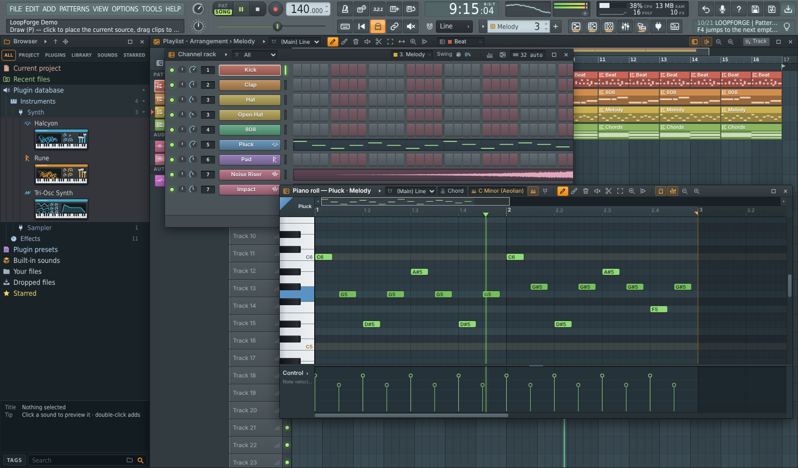

# LoopForge Studio

A pattern-based desktop DAW that works like FL Studio — **same workflow, same keyboard shortcuts** — rebuilt to fix the annoying parts. Windows `.exe` (installer + portable), with Linux and macOS builds from the same code.



> Independent project. Not affiliated with or endorsed by Image-Line. "FL Studio" is a trademark of Image-Line Software. LoopForge uses its own code, visuals, names and procedurally generated sounds.

## What's inside

| Window | Key | Highlights |
|---|---|---|
| Playlist | F5 | Pattern / audio / automation clips, all 9 FL tools, time-selection looping, clip picker |
| Channel Rack | F6 | Step sequencer with grey/red step groups, mini piano-roll previews, swing, groups, drag & drop samples |
| Piano Roll | F7 | Every FL piano-roll shortcut, ghost notes, velocity/pan lane, quantize/arp/strum/chop/flam/limit/flip/randomize dialogs, scale highlight + snap-to-scale, chord stamps |
| Plugin picker | F8 | Instruments and effects, fuzzy search |
| Browser | Alt+F8 | 27 built-in sounds, synth presets, your folders, favourites, fuzzy search |
| Mixer | F9 | Unlimited inserts, routing arrows, 10 FX slots per track, automatic plugin delay compensation, live audio input + arm, EQ graph, meters, solo/mute, stem render |

- **Halcyon — wavetable synth:** 3 morphing wavetable oscillators (12 generated tables, 9 warp modes, 16-voice unison), sub + noise, 2 filters, 3 envelopes, 4 LFOs with custom shapes, 16-slot mod matrix, macros, FX; 32 presets.
- **Rune — analog-style poly synth:** 3 oscillators (analog, supersaw, FM, PM, chip, noise, vector), 2 filters (ladder, SVF, SEM, K-35, diode, comb, formant, ring), mod matrix, arpeggiator/step sequencer, glide/legato/unison, FX; 33 presets.
- **Riffstack — guitar amp rack:** noise gate, tuner, compressor/wah/fuzz/overdrive pedals, 6 amp models from clean to **Molten Core** (metal) and **Razor** (djent), procedurally generated 1x12–4x12 cabinets with movable mic, EQ, delay, reverb; 16 presets.
- **Also:** Sampler, Tri-Osc Synth, and 10 mixer effects (EQ, compressor, limiter, reverb, delay, filter, distortion, bitcrusher, chorus, stereo width). Plugins open in FL-style plugin windows with presets and channel controls; 4 macros per synth are automatable from the playlist.
- **Guitar / mic input & recording:** pick an input on any mixer insert (Mixer → top of the right panel) to play live through its effects — e.g. your guitar through Riffstack. Arm the insert, press Record and Play, and the take lands in the Playlist routed to that insert.
- **Export:** WAV 16/24/32-float at 44.1/48/96 kHz (song or pattern), MIDI export/import, per-track stems.
- **Projects:** `.lfproj` (JSON), optional embedded samples, autosave + crash recovery.

### FL Studio shortcuts
Every shortcut from FL's manual tables is implemented and context-sensitive (the focused window's keys win, then global): Space, Ctrl+Space, L, R, Ctrl+T, Ctrl+B, Backspace, F5–F12, Alt+F8, 1–9, Num+/−, F2, F4, P/B/D/T/C/E/S/Z/Y tools, Ctrl+Q, Alt+Q, Ctrl+L, Alt+A, Alt+S, Shift/Ctrl+arrows, Alt+Del, Alt+C, Ctrl+L routing, S solo in the mixer… The full list is in [`PROMPT.md`](PROMPT.md); press **F1** in the app for the cheat sheet.

### "Just better" than FL
Real multi-level undo (FL-classic toggle available) · command palette (Ctrl+K) · fully remappable keys with conflict detection · autosave & crash recovery · no track/insert/pattern limits · scale tools in the piano roll · fuzzy search everywhere · hint bar + shortcut tooltips on every control · a precise, crash-proof single-file project format.

## Run it

**Windows:** run `LoopForge-Studio-Setup-<version>.exe` (installer), or `LoopForge-Studio-Portable-<version>.exe` (no install). The builds aren't code-signed, so Windows SmartScreen may warn the first time — choose *More info → Run anyway*.

**From source** (Node 20+):

```bash
npm install
npm run dev          # desktop app with hot reload
npm run web          # same app in your browser at http://localhost:5173
npm run dist:win     # Windows installer + portable exe  -> release/
npm run dist:linux   # Linux AppImage
npm run dist:mac     # macOS dmg (run on a Mac)
```

Building the Windows `.exe` on Linux needs Wine (`wine64` + `wine32`); on Windows it just works.

## Project layout

```
electron/        main process (window, native dialogs, safe file IPC) + preload
src/core/        data model, undoable store, commands/keymap, params, MIDI, timing
src/audio/       Web Audio engine: look-ahead scheduler, instruments, mixer graph, effects, offline export, audio input
src/audio/plugins/  Halcyon, Rune, Riffstack (AudioWorklet DSP + UIs) and the plugin registry
src/ui/          toolbar, window manager, and one module per window (playlist, channelRack, pianoRoll, mixer, browser…)
PROMPT.md        the master build prompt / spec this app was built from
docs/            architecture notes and screenshot
```

See [`docs/ARCHITECTURE.md`](docs/ARCHITECTURE.md) for how the pieces fit together and [`docs/PLUGINS.md`](docs/PLUGINS.md) for writing plugins.

## License
MIT
